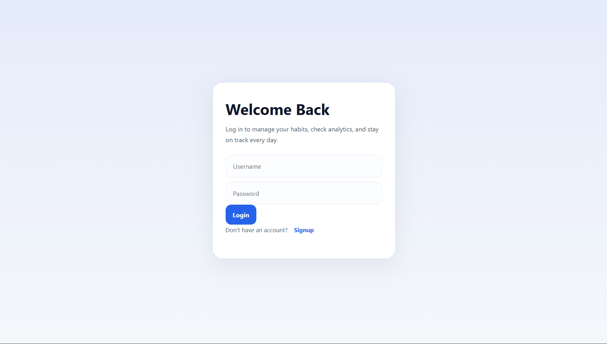
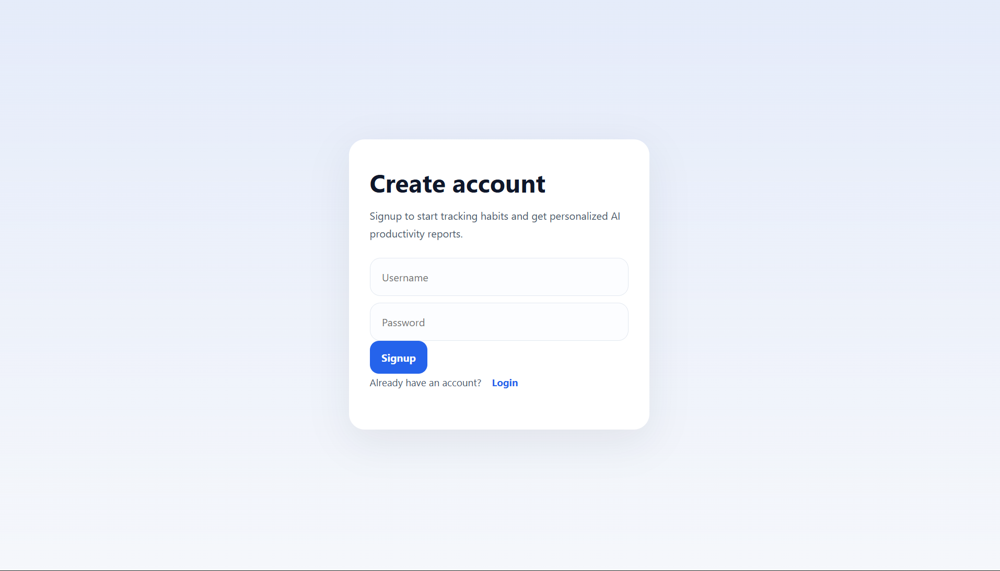
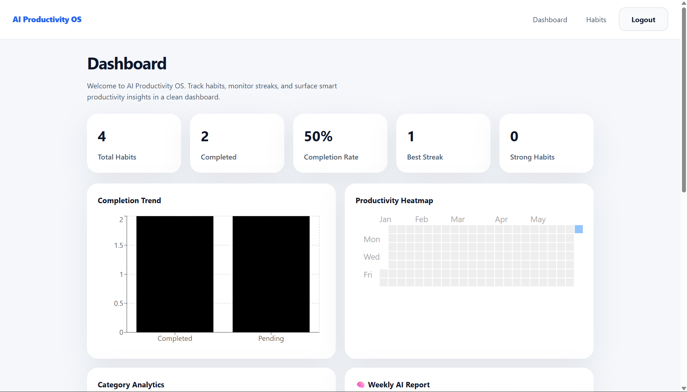
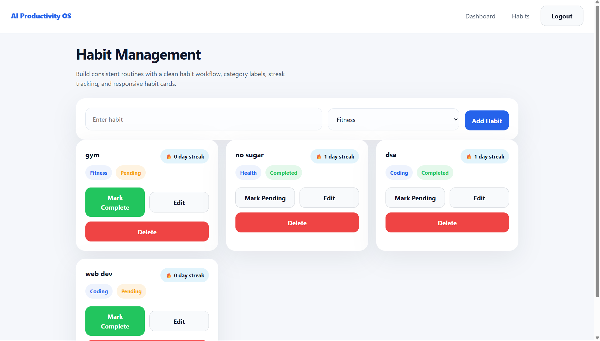
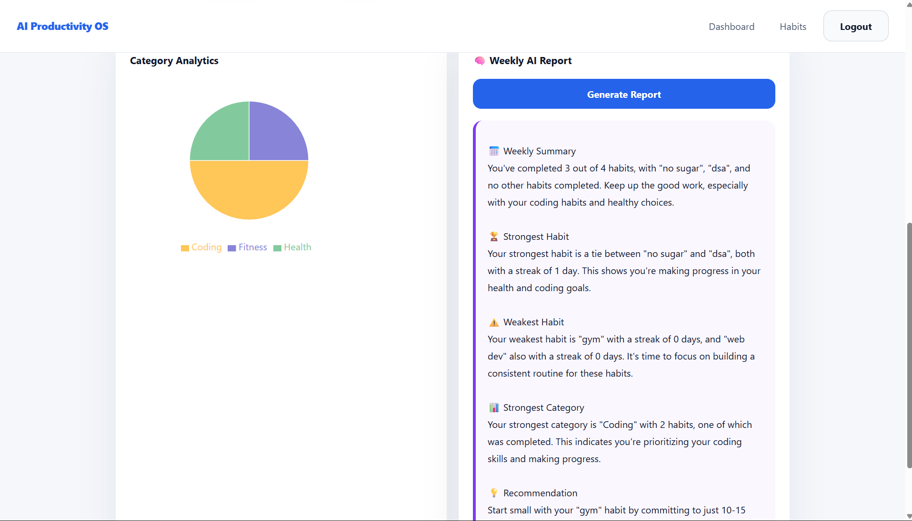

# AI Productivity Hub

An AI-powered productivity platform that helps users build habits, track streaks, visualize progress, and receive personalized productivity insights.

## Overview

AI Productivity Hub combines habit tracking, analytics, and AI-generated recommendations into a single dashboard. Users can create habits, track daily progress, monitor streaks, and receive actionable suggestions powered by Groq LLMs.

## Features

### Authentication

* User Signup and Login
* JWT-based Authentication
* Protected Routes
* Persistent User Data with MongoDB Atlas

### Habit Tracking

* Create, Edit, Delete Habits
* Habit Categories
* Daily Completion Tracking
* Streak Management

### Analytics Dashboard

* Habit Completion Statistics
* Productivity Heatmap
* Category Distribution Analytics
* Performance Insights

### AI Productivity Reports

* Weekly Productivity Summary
* Strongest Habit Detection
* Weakest Habit Detection
* Category Analysis
* Personalized Recommendations

## Tech Stack

### Frontend

* React
* React Router
* Context API
* Recharts
* React Calendar Heatmap
* CSS

### Backend

* Node.js
* Express.js
* JWT Authentication
* MongoDB Atlas
* Mongoose

### AI

* Groq API
* Llama Models

## Architecture

## System Architecture

```text
┌─────────────┐
│ React Frontend │
└──────┬──────┘
       │
       ▼
┌─────────────┐
│ Express API │
└───┬─────┬───┘
    │     │
    ▼     ▼
┌──────────┐  ┌─────────┐
│ MongoDB  │  │  Groq   │
│  Atlas   │  │   AI    │
└──────────┘  └─────────┘
```
## Screenshots

### Login Page



### Signup Page



### Dashboard



### Habits Page



### AI Insights



## Local Setup

### Clone Repository

git clone <repo-url>

### Backend

cd backend

npm install

Create a .env file:

PORT=3000

JWT_SECRET=your_secret

MONGO_URI=your_mongodb_uri

GROQ_API_KEY=your_groq_api_key

npm start

### Frontend

cd frontend

npm install

Create a .env file:

VITE_API_URL=http://localhost:3000

npm run dev

## Future Improvements

* Productivity Score Trends
* Smart Goal Planning
* Habit Reminders
* AI Goal Coaching
* Mobile Application

## Author

Chandra Vardhan Reddy
